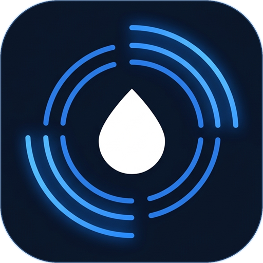

<p align="center">
  
</p>

# LanDrop

LanDrop transfers files between Windows and Android devices over a local network without an internet connection. It is a fork of [LocalSend](https://github.com/localsend/localsend) built for offline Windows 11 and Android use.

## Downloads

Download the installers from the [v1.0.0 release](https://github.com/jake-dev-official/LanDrop/releases/tag/v1.0.0):

| Platform | File | Size |
| --- | --- | --- |
| Windows 64-bit | `LanDrop-1.0.0-Setup.exe` | 24.0 MB |
| Android 64-bit ARM | `LanDrop-1.0.0-Android-arm64.apk` | 44.1 MB |

## What changed from LocalSend

- **Windows 11 right-click menu.** A C++ shell extension adds a Send with LanDrop menu to File Explorer. Right-click a file or folder and pick a remembered device to start a transfer without opening the main window.
- **Immediate mid-transfer cancel.** Canceling from the app or a notification triggers a Rust `CancellationToken` on the active upload session, closes the HTTP stream, and deletes partial files on disk.
- **Offline send queue.** Transfers started while a remembered target is unreachable stay queued for 5 minutes and send as soon as that device comes back online.
- **Live presence and real device names.** Android reads the system device name instead of the hardware model, and Windows reads the host name. Refresh clears stale entries, and a network change resets the nearby list.
- **Single-card settings and receive chime.** All settings are in one card. Finished transfers play a single completion chime on the receiving device with selectable WAV presets.
- **Windows installer.** The Inno Setup executable installs to `C:\Program Files\LanDrop`, bundles the Visual C++ runtime libraries, adds inbound TCP and UDP allow rules in Windows Firewall, and registers the Windows 11 shell package.

## Install on Windows

Run `LanDrop-1.0.0-Setup.exe`.

1. Choose an install folder or keep `C:\Program Files\LanDrop`.
2. Choose whether to add a desktop shortcut and the Windows 11 right-click menu.
3. Click Install, then click Finish.

The installer is unsigned, so Windows SmartScreen may show a warning on the first run. Click More info, then click Run anyway.

The installer removes conflicting block rules and adds inbound TCP and UDP allow rules for `landrop.exe` on private and public networks, which covers phone hotspots.

## Install on Android

Install `LanDrop-1.0.0-Android-arm64.apk` on a 64-bit Android phone. The package ID is `com.jake.landrop`.

LanDrop runs an Android foreground service to keep transfers active while the screen is off and registers a boot receiver to restart the listener after a reboot. Some phone makers stop background apps after long idle periods. To keep receiving while the phone is locked:

- On Honor and Huawei phones, open Settings, then Battery, then App launch, select LanDrop, and turn on Auto-launch and Run in background.
- On other Android phones, open Settings, then Apps, then LanDrop, then Battery, and select Unrestricted.

## Architecture

LanDrop uses the LocalSend v2 protocol over HTTPS with per-device TLS certificates on port 53317 and UDP multicast discovery on `224.0.0.167`.

- `app` contains the Flutter user interface, Refena state providers, Android Kotlin services, Windows runner, and Windows shell extension.
- `packages/localsend_isolates` runs discovery, HTTP uploads, and the server in background Dart isolates through `flutter_rust_bridge`.
- `packages/core` contains the Rust HTTP server, client, TLS, and multicast implementation.
- `support/scripts` contains the MSIX packaging script and the Inno Setup installer script.

## Build from source

To build LanDrop, install the Flutter SDK version pinned in `.fvmrc`, the Rust toolchain, the Android NDK for Android builds, Visual Studio Build Tools for Windows builds, and Inno Setup 6 for the Windows installer.

Build the Windows release:

```powershell
cd app
flutter pub get
flutter build windows --release
```

Build the Android 64-bit ARM release APK:

```powershell
cd app
flutter build apk --release --target-platform android-arm64
```

Build the Windows installer from a staged Windows release folder:

```powershell
.\support\scripts\build_windows_setup.ps1 -PayloadDir <path-to-release-folder> -ResultDir <output-folder>
```

## License and attribution

LanDrop is licensed under the [Apache License 2.0](LICENSE). It is a fork of [LocalSend](https://github.com/localsend/localsend), created by Tien Do Nam and contributors.
